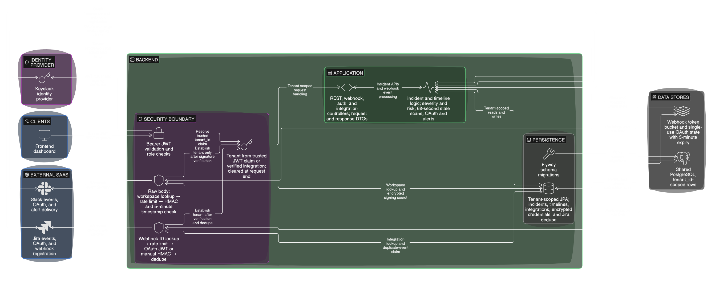

# Context Broker 

<p align="center">
  
</p>


Production-oriented multi-tenant backend that consolidates Slack/Jira incident signals into one tenant-scoped incident model, applies severity/risk logic, and drives timeline + alert workflows for operations teams.

## 01. Project title

**SaaS Context Broker** — incident intelligence backend for SaaS operations, built with Spring Boot, PostgreSQL, Redis, Keycloak JWT, and Flyway.

## 02. Overview and problem statement

Incident context is usually fragmented: Slack has real-time updates, Jira has workflow state, and dashboards need stable analytics. Teams lose time switching tools, and incident severity can be inconsistently assessed.

Context Broker exists to centralize those streams into one API and one persistence model per tenant. Incoming Slack/Jira updates are normalized into a shared incident timeline, then scored for severity and risk so downstream dashboards and responders can act consistently.

## 03. Key features

1. Multi-tenancy with per-request `tenant_id` resolution and tenant-scoped persistence.
2. Slack/Jira webhook ingestion with signature/JWT verification and Redis-based rate limiting.
3. Incident lifecycle handling (`CREATED`, `IN_PROGRESS`, `RESOLVED`, `CLOSED`) with configurable scoring.
4. Unified timeline logging across Slack, Jira, and internal system decisions.
5. Scheduled stale-incident monitoring with cooldown-aware Slack escalations.
6. Integration APIs for Slack/Jira manual + OAuth connection management.

## 04. Architecture


The diagram above provides an overview of the architecture. For a clearer view of the components and application flow, [view the full-resolution diagram on Google Drive](https://drive.google.com/file/d/1uYKo_vGVEs_7L1K7Zd8Z9MOChXtxPota/view?usp=sharing).


**Main components**

1. **Ingress/security**: `SecurityConfig`, webhook filters, signature validators, rate limiter.
2. **Tenant isolation**: `TenantFilter`, `TenantResolver`, `TenantContext`, tenant-scoped repositories.
3. **Core domain**: `IncidentService`, `TimelineService`, `IncidentMonitor`, `SlackNotifier`.
4. **Persistence**: PostgreSQL entities + Flyway migrations with tenant constraints/indexes.
5. **External dependencies**: Keycloak (JWT + admin), Slack API, Jira/Atlassian API, Redis.

**Detailed flow diagrams**

1. Security boundaries + request/persistence path: `docs/images/backend-security-architecture.png`
2. Slack/Jira ingestion and incident pipeline: `docs/images/incident-processing-flow.png`

## 05. Security design

1. **JWT validation**: Spring OAuth2 Resource Server validates bearer tokens against `KEYCLOAK_ISSUER_URI`; role mapping uses Keycloak client roles (`context-broker`).
2. **Tenant isolation**: tenant is read from JWT claim `tenant_id`, stored in `TenantContext`, and enforced in service/repository lookups (`findByTenantId...` patterns).
3. **Webhook verification**:
   - Slack: `X-Slack-Signature` + `X-Slack-Request-Timestamp` (HMAC SHA-256, replay window).
   - Jira manual webhook: `X-Hub-Signature` verification.
   - Jira OAuth webhook: bearer JWT verification (`HS256` with Jira OAuth client secret).
4. **Credential encryption**: integration secrets/tokens are encrypted at rest using AES-GCM (`CredentialEncryptionService`) and decrypted only for verification/use.
5. **Authorization model**:
   - `/incoming/**` is public only for webhook callbacks, but protected by signature/JWT filters.
   - Incident/Integration operations use JWT auth + method-level role checks (`USER`, `ADMIN`).
   - Tenant bootstrap (`/api/auth/register`) creates tenant + first admin user in Keycloak.

## 06. Tech stack and prerequisites

**Backend stack (verified from `pom.xml` and code):**

- Java 21
- Spring Boot 4.0.2
- Spring Web MVC, Spring Security, OAuth2 Resource Server
- Spring Data JPA + PostgreSQL driver
- Spring Data Redis
- Flyway migrations
- Maven wrapper (`mvnw`, `mvnw.cmd`)

**Prerequisites**

1. JDK 21
2. PostgreSQL (local or managed)
3. Redis (for webhook rate limiting)
4. Keycloak realm/client setup for JWT issuer + admin client

## 07. Getting started

### 1) Clone

```bash
git clone https://github.com/05Har-sh/SaaS-Context-Broker.git
cd SaaS-Context-Broker
```

### 2) Configure environment

Copy values into your shell, `.env`, or IDE run configuration (see Section 08 for full reference).

### 3) Start dependencies

Start PostgreSQL, Redis, and Keycloak, then ensure:

- PostgreSQL is reachable at `DB_URL`
- Redis is reachable at `spring.data.redis.host:port`
- Keycloak realm/client exist and `KEYCLOAK_ISSUER_URI` resolves

### 4) Run migrations + app

Flyway runs on startup.

**Windows**

```powershell
.\mvnw.cmd spring-boot:run
```

**macOS/Linux**

```bash
./mvnw spring-boot:run
```

### 5) Build artifact

```powershell
.\mvnw.cmd -DskipTests package
```

## 08. Configuration reference

> Use real secrets in environment variables only. Never commit secrets to Git.

| Variable | Required | Safe example value | Purpose |
|---|---|---|---|
| `DB_URL` | Yes | `jdbc:postgresql://localhost:5432/context_broker` | PostgreSQL JDBC URL |
| `DB_USERNAME` | Yes | `postgres` | DB username |
| `DB_PASSWORD` | Yes | `change-me` | DB password |
| `JPA_DDL_AUTO` | No | `validate` | JPA schema mode |
| `JPA_SHOW_SQL` | No | `false` | SQL logging |
| `KEYCLOAK_ISSUER_URI` | Yes | `http://localhost:8080/realms/context-broker-dev` | JWT issuer for resource server |
| `KEYCLOAK_SERVER_URL` | Yes (registration flow) | `http://localhost:8080` | Keycloak admin base URL |
| `KEYCLOAK_REALM` | Yes (registration flow) | `context-broker-dev` | Keycloak realm |
| `KEYCLOAK_ADMIN_CLIENT_ID` | Yes (registration flow) | `context-broker-admin` | Keycloak admin client |
| `KEYCLOAK_ADMIN_CLIENT_SECRET` | Yes (registration flow) | `set-in-env` | Keycloak admin secret |
| `CREDENTIAL_ENCRYPTION_KEY` | Yes | `MDEyMzQ1Njc4OWFiY2RlZjAxMjM0NTY3ODlhYmNkZWY=` | AES key material for encrypting stored credentials |
| `SLACK_CLIENT_ID` | Optional (OAuth) | `1234567890.abcde` | Slack OAuth client ID |
| `SLACK_CLIENT_SECRET` | Optional (OAuth) | `set-in-env` | Slack OAuth client secret |
| `SLACK_SIGNING_SECRET` | Optional (OAuth/manual webhook setup) | `set-in-env` | Slack webhook signature secret |
| `SLACK_OAUTH_REDIRECT_URI` | Optional | `http://localhost:8081/integrations/slack/oauth/callback` | Slack callback URL |
| `SLACK_OAUTH_SCOPES` | Optional | `channels:history,channels:read` | Slack OAuth scopes |
| `JIRA_CLIENT_ID` | Optional (OAuth) | `jira-client-id` | Jira OAuth client ID |
| `JIRA_CLIENT_SECRET` | Optional (OAuth) | `set-in-env` | Jira OAuth secret |
| `JIRA_OAUTH_REDIRECT_URI` | Optional (OAuth) | `http://localhost:8081/integrations/jira/oauth/callback` | Jira callback URL |
| `JIRA_OAUTH_SCOPES` | Optional | `read:jira-work write:jira-work offline_access manage:jira-webhook` | Jira OAuth scopes |
| `JIRA_WEBHOOK_URL` | Optional | `https://your-domain/incoming/jira` | Callback URL Jira calls |
| `JIRA_WEBHOOK_JQL` | Optional | `project=OPS AND statusCategory!=Done` | Jira webhook filter |
| `FRONTEND_URL` | No | `http://localhost:3000` | OAuth callback redirect base |
| `FLYWAY_ENABLED` | No | `true` | Toggle Flyway |
| `FLYWAY_BASELINE_ON_MIGRATE` | No | `true` | Baseline handling |

**Scoring config (`application.yml`)**

- `scoring.urgent`
- `scoring.jiraOpen`
- `scoring.jiraInProgress`
- `scoring.stale`
- `staleness.threshold.minutes`

## 09. Incident processing flow


The diagram above provides an overview of the Incident processing flow. For a clearer view of the components and application flow, [view the full-resolution diagram on Google Drive](https://drive.google.com/file/d/1a71Ig7-HpIYiVDip45iWejTJ_YfpsIeY/view?usp=sharing).


### Authentication

- Protected APIs require a bearer JWT in the standard HTTP auth header.
- JWT must contain tenant claim `tenant_id`.
- Role-protected endpoints use Keycloak client roles mapped to `ROLE_USER` / `ROLE_ADMIN`.

### Webhook endpoints

| Endpoint | Auth mode | Notes |
|---|---|---|
| `POST /incoming/slack` | Slack signature headers | Supports `url_verification` and `event_callback` |
| `POST /incoming/jira` | Jira signature or OAuth webhook JWT | Requires webhook identifier header and dedup logic |

### Incident APIs

- `GET /incident/{incidentKey}`
- `GET /incident/{incidentKey}/timeline`
- `GET /incident/incident-details/{incidentKey}`
- `GET /incident/metrics`
- `GET /incident/all?page=0&size=10&severity=HIGH&assignedTo=alice&stale=true&jiraStatus=OPEN`
- `GET /incident/system-health`
- `GET /incident/risk-score/{incidentKey}`
- `GET /incident/priority/{incidentKey}`
- `GET /incident/highest-risk`
- `GET /incident/severity-distribution`
- `GET /incident/trend`
- `POST /incident/{incidentKey}/assign` (ADMIN)

### Integration APIs

- `POST /integrations/slack` (ADMIN, manual setup)
- `GET /integrations/slack/status`
- `DELETE /integrations/slack`
- `POST /integrations/jira` (ADMIN, manual setup)
- `GET /integrations/jira/status`
- `DELETE /integrations/jira/{integrationId}`
- `GET /integrations` (cross-integration summary)
- `GET /integrations/slack/oauth/authorize`, `GET /integrations/slack/oauth/callback`
- `GET /integrations/jira/oauth/authorize`, `GET /integrations/jira/oauth/callback`

### Tenant bootstrap API

- `POST /api/auth/register` creates tenant + first admin user (via Keycloak admin API).

## 10. Testing and code quality

**Build**

```powershell
.\mvnw.cmd -DskipTests package
```

**Test command that works on the current codebase**

```powershell
$env:CREDENTIAL_ENCRYPTION_KEY="MDEyMzQ1Njc4OWFiY2RlZjAxMjM0NTY3ODlhYmNkZWY="
.\mvnw.cmd test -Dtest='!AtlassianOAuthClientTest,!IntegrationServiceTest,!CredentialEncryptionServiceManualTest'
```

## 11. Deployment and operations

1. Use `staging` / `prod` Spring profiles with environment-driven secrets.
2. Keep `spring.jpa.hibernate.ddl-auto=validate` and rely on Flyway migrations.
3. Expose actuator health endpoint (`/actuator/health`) for probes.
4. Configure centralized logs and alerts for rejected webhooks/auth failures.
5. Store all secrets in a secret manager (Vault, cloud secrets, or CI/CD protected vars).
6. Ensure Redis capacity/refill config is tuned for expected webhook volume.

## 12. Project structure & contribution

### Important packages

- `controller/` and `controller/**`: REST and OAuth callback surfaces
- `security/`: JWT security, webhook verification, rate limiting, credential encryption
- `tenant/`: tenant resolution and per-request tenant context
- `service/`: incident processing, timeline, monitoring, integrations, auth registration
- `entity/` + `repository/`: persistence model and tenant-scoped data access
- `src/main/resources/db/migration/`: Flyway schema evolution


### Contribution workflow

1. Create a feature branch from `main`.
2. Make focused changes with tests or updated documentation.
3. Run build/test commands in Section 10.
4. Open a PR with architecture/security impact notes for any behavior change.

## 13. Frontend repository: [Link](https://github.com/05Har-sh/context-broker-web)
